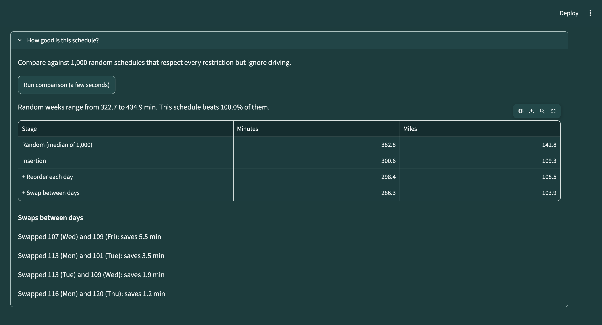
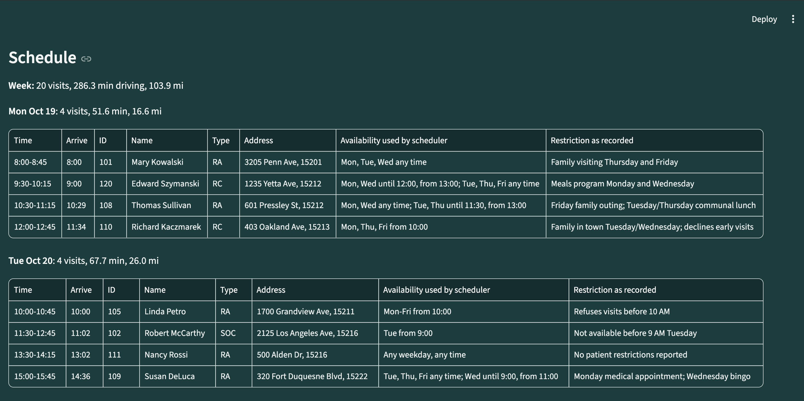
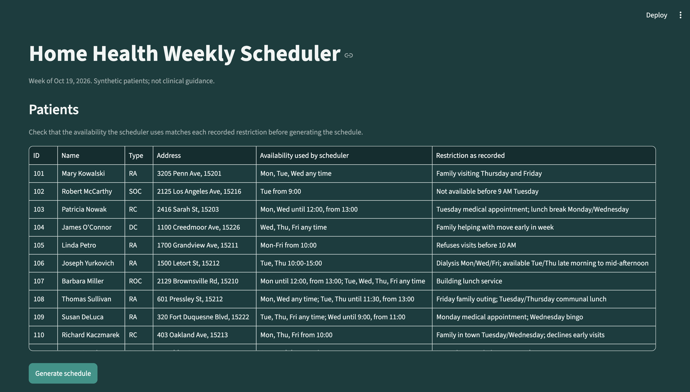

# Patient Routing Tool

A Python-based scheduling and route optimization tool designed for home-health clinicians.

## Project Overview

Home-health clinicians must coordinate patient visits across a workweek while accounting for clinical deadlines, patient scheduling restrictions, visit durations, and geographical travel.

This project automates that process: it generates a feasible weekly schedule and optimizes patient assignments across days to reduce driving, replacing the trial-and-error scheduling a clinician normally does by hand.

The scheduling approach is inspired by real-world home-health workflows: place the most constrained visits first, build geographical clusters around them, fill with flexible visits, then rearrange visits across the week to improve overall efficiency.

## Results

Week of October 19, 2026: 20 patients, one clinician, up to four visits per day. Driving includes the trips to and from home.

| Stage | Weekly driving (min) | Miles |
|---|---:|---:|
| Random valid schedule (median of 1,000) | 382.8 | 142.8 |
| Regret insertion | 300.6 | 109.3 |
| + Exact reordering within each day | 298.4 | 108.5 |
| + Swaps between days | **286.3** | **103.9** |
| Proven optimum (OR-Tools, benchmark only) | 279.9 | 100.0 |

- The final schedule drives **25% less** than a typical random schedule that respects every restriction, and beats all 1,000 random schedules (the best random week drove 322.7 min).
- It is **2.3% above the proven optimum**, closing about 94% of the gap between a random week and the best possible week.
- Each stage only accepts changes that keep every day valid; the totals can only go down.



### Scenario check

| Scenario | Result |
|---|---|
| Tuesday SOC beyond the Liberty Tunnel; a flexible neighbor should join it | Both on Tuesday |
| Wednesday SOC beyond the tunnel forces a second trip; a nearby discharge should join it | Both on Wednesday |
| Dialysis patient (Tue/Thu only) should avoid the Tuesday tunnel day | Thursday, with other North Side patients |
| Patient available only 14:00–17:00 | Last visit Thursday, 14:00 |
| Two patients both limited to Thursday 9:00–10:30 on opposite sides of the river | One Thursday, one moved to Friday |
| Two patients in the same senior building | Back to back on Friday, no driving or parking |

### What the stages show

- **Regret insertion does most of the work.** Placing the most constrained patients first and protecting patients with few good options came within 7.4% of the optimum on its own.
- **Reordering within days adds little.** Insertion already tries every position for each patient, so each day starts close to its best order.
- **Swaps fix what greedy insertion cannot.** Insertion placed the two same-building patients on different days because one day filled before the second patient was reached. Swapping patients between days put them together.
- **Local search stops at a local optimum.** The optimum puts the same-building pair on Wednesday, alongside that day's trip south; no single swap leads there from the heuristic's week.

### Generated schedule

First two days of the week; each visit shows its appointment time, arrival, address, and the restriction behind it.



## Technical Approach

1. **Availability:** each patient's restrictions are parsed into hard time windows per day, independent of clinician hours.
2. **Day simulation:** a day's route (home → patients → home) is checked against windows, a 7-minute parking buffer, half-hour appointment starts, 8:00–17:00 hours, and the visit limit.
3. **Regret insertion:** each step finds every unplaced patient's cheapest feasible insertion on each day and places the patient whose best day beats their second-best day by the most (the "regret"). Patients with only one possible day go first.
4. **Exact reordering:** every visit order for each day is tried (at most 24) and the shortest valid order kept.
5. **Swaps between days:** local search repeatedly applies the patient swap between two days that saves the most driving, until no swap helps.
6. **Baselines:** 1,000 random valid schedules (seeded) and an exact optimum. The optimum lists every feasible patient group per day using the same day simulation, then OR-Tools CP-SAT chooses one group per day covering each patient once. This is only practical because the instance is small, which is why the app uses the heuristic.

The optimization objective is to minimize weekly driving time while respecting these priorities:

1. Clinical scheduling requirements and hard patient restrictions.
2. Clinician routing efficiency.
3. Patient soft scheduling preferences (not yet used by the scheduler).

Travel times come from a precomputed, directed (A→B ≠ B→A) distance matrix built with the openrouteservice API, behind an interface so time-of-day travel can be added later.

## Running the Project

```bash
pip install -r requirements.txt

python3 -m streamlit run app.py   # web app: review patients, generate the schedule
python3 main.py                   # same schedule printed in the terminal
python3 -m pytest                 # tests

# Exact benchmark (optional, run on demand)
pip install -r requirements-benchmark.txt
python3 benchmark.py
```

The web app shows each patient's recorded restriction next to the availability the scheduler actually uses, so a clinician can check the input before trusting the output. After generating, visits are listed by day and time with the same patient details, plus a comparison against random schedules.

The geocoded coordinates and distance matrix are committed. Rebuilding them needs an openrouteservice API key in `.env` (`ORS_API_KEY`): `python3 generate_distance_matrix.py` geocodes for review, then `--generate` builds the matrix.

| File | Purpose |
|---|---|
| `patient.py` | Load patients and build availability windows |
| `clinician.py`, `visit_rules.py` | Clinician hours and limits; visit durations |
| `travel.py` | Drive time and distance lookups |
| `schedule.py` | Day simulation and feasibility |
| `insertion.py` | Regret insertion |
| `reorder.py` | Exact reordering within a day |
| `swaps.py` | Swaps between days |
| `baseline.py` | Random valid schedules |
| `benchmark.py` | Exact optimum with OR-Tools |
| `main.py`, `app.py`, `display.py` | Terminal output, web app, shared formatting |

## Synthetic Dataset

The project uses 20 fictional patient records spread across a realistic single-clinician territory in Pittsburgh, Pennsylvania: downtown and the Hill District (15219, 15222), Oakland and Lawrenceville (15201, 15213), the North Side (15212, 15214), south of the Monongahela (15203, 15210, 15211), and beyond the Liberty Tunnel (15216, 15226). The clinician lives just outside the territory near Frick Park (15217). Pittsburgh was chosen for its terrain: three rivers, many bridges, and two tunnels make day assignment and visit order matter.



The data deliberately includes scenarios that test the scheduler:

- **Tunnel trips:** Medicare fixes two start-of-care visits beyond the tunnel on different days, forcing two trips; flexible nearby patients should join those days.
- **Dialysis:** a North Side patient available only Tuesday/Thursday should be pulled away from the tunnel day.
- **Narrow windows:** one patient is available only 14:00–17:00; two patients on opposite sides of the river are both limited to Thursday 9:00–10:30, so one must move.
- **Same building:** two patients live in one senior building; consecutive visits there need no driving or parking.

Patient locations use public-address stand-ins (apartment buildings, senior housing, and local businesses) rather than actual residential or patient addresses. All patient identities, clinical information, and scheduling restrictions are synthetic.

The dataset includes:

- Patient identifiers and names
- Visit types (SOC: start of care, RC: recertification, ROC: resumption of care, RA: reassessment, DC: discharge)
- Certification-period information and scheduling windows
- Patient scheduling restrictions and preferences

Patients are assumed available during clinician working hours unless a specific restriction applies.

## Scheduling Assumptions

- **Target week:** Monday–Friday, October 19–23, 2026.
- **Clinician:** one clinician working 8:00 AM–5:00 PM, up to four visits per day (configurable in code). Each day starts and ends at the clinician's home base; those drives fall outside work hours but count toward driving.
- **Visit frequency:** one visit per patient per week, the standard frequency in home health.
- **Visit durations:** 45 minutes, except start of care (SOC) at 75 minutes and discharge (DC) at 30 minutes. Driving and parking are modeled separately.
- **Timing:** a 7-minute parking buffer after each drive (none between patients at the same address). Visits start on the half hour; the clinician never starts early and waits (documenting) when early.
- **Mandatory days:** SOC visits occur on a fixed day. Visit times are never fixed.
- **Discharge (DC) and resumption of care (ROC):** a DC day must be set 48 hours in advance and an ROC day is agreed with the patient. Because schedules are assumed to be built the week prior, the scheduler chooses these days, limited only by patient and clinician availability.
- **Recertification (RC):** must occur within the five-day window ending on the last day of the certification period.
- **Availability:** patient data records exceptions rather than full availability. `restricted_days` and `restricted_times` are hard restrictions. For low-availability patients, `available_times` limits visits to the listed windows; days not listed are unavailable. Restricted times are applied after available times.
- **Preferences:** `preferred_days` and `preferred_times` are soft and never override hard restrictions.
- **Travel:** static drive times without traffic; tunnel and bridge congestion are not yet modeled.

## Completed

- Synthetic patient data, reviewed geocodes, and a cached travel matrix from the openrouteservice API.
- Visit-type rules, hard availability windows, visit durations, parking, and working hours.
- Regret insertion, exact reordering within each day, and swaps between days.
- Benchmarks against 1,000 random valid schedules and the proven optimum (OR-Tools).
- Streamlit interface to review patients and the generated schedule.

## Future Work

- **Soft preferences:** score preferred days and times after driving, and report how many minutes honoring them costs.
- **Open slots:** move a patient into an empty slot, not only swap; this matters once days are not all full.
- **Flexible visits per day:** the limit is already a setting in code; real caseloads vary by day, so it belongs in the interface.
- **Selectable work days and hours:** part-time and weekend clinicians are common in home health.
- **Wait limit:** waiting costs nothing in the model, but long idle gaps make a day feel worse than its drive time suggests.
- **Time-of-day travel:** tunnel and bridge congestion can change which day or order is cheapest.
- **Other clinicians' appointments:** shared patients (PT, OT, nursing) should not be visited at the same time.
- **Workload balance:** the lowest-driving week may stack long days; a clinician may accept a little more driving for even days.
- **Route maps:** a map shows a clinician at a glance why a day is ordered the way it is.
- **Editing patients and visits in the interface:** add patients (with geocoding), move a visit by hand, and re-optimize around it.

## Current Status

**MVP and weekly optimization complete.** The scheduler, swaps between days, random and exact benchmarks, and a Streamlit interface are implemented and tested. See Future Work for planned extensions.

## Background

This project builds on concepts explored in a previous package-routing optimization assignment, including address indexing, distance matrices, and nearest-neighbor routing.

Unlike the original delivery-routing problem, home-health scheduling requires assigning appointments across multiple days while satisfying patient-specific time restrictions and clinical scheduling requirements.

The goal is a practical scheduling heuristic, evaluated honestly against both a naive baseline and the true optimum.

## Disclaimer

This is a portfolio and educational project. It does not use protected health information (PHI), and it is not intended for clinical deployment. Clinical scheduling assumptions are simplified for development and should not be interpreted as authoritative Medicare guidance.
